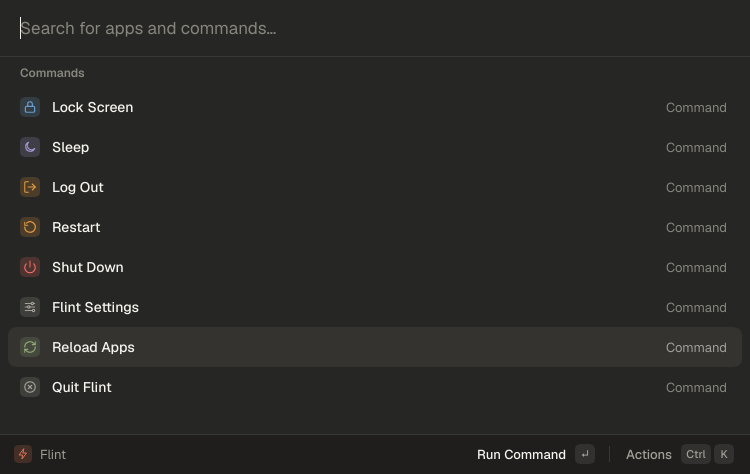
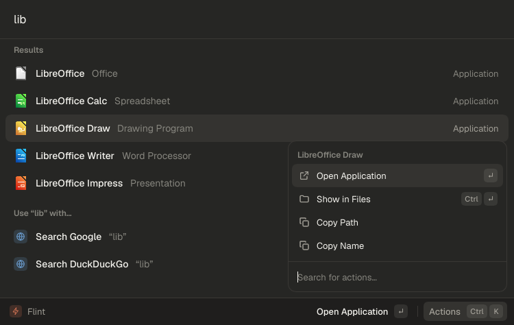
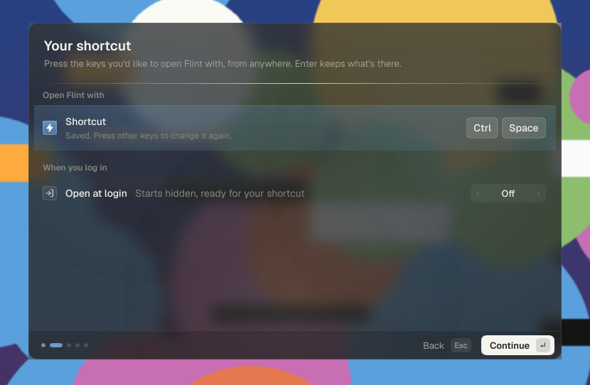
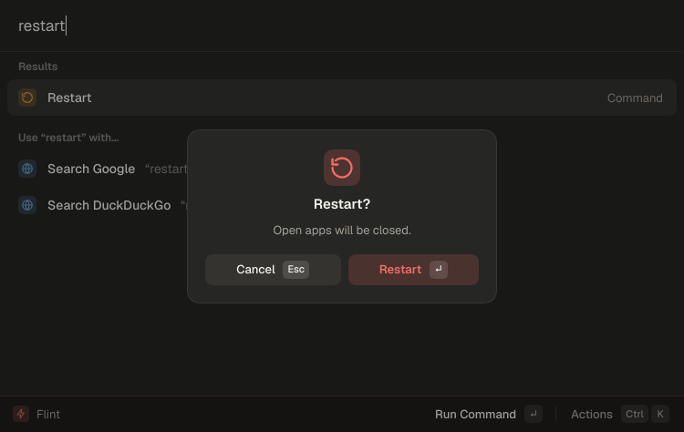

# Tendril

By Loam, alongside [Blight](https://github.com/bluejutzu/blight).

A keyboard launcher in the style of Raycast. Press Alt+Space, type a few letters, press Enter.

It's a native program: Rust, with the UI drawn by [Slint](https://slint.dev) on the CPU. There's no browser engine
inside it, no GPU context, no account, no AI and nothing sent anywhere. When the window is closed it's destroyed, so
between uses Tendril holds a list of your apps and little else.


| Favourites and commands            | Details beside the list                    | Actions (Ctrl K)                       |
| ---------------------------------- | ------------------------------------------ | -------------------------------------- |
|        |                |            |
| **Appearance**                     | **Compact, with quick keys**               | **The calculator**                     |
|  |                |  |
| **First run**                      | **Recording your shortcut**                | **Before logging out or similar**      |
|        |              |         |

## What it costs

Measured with the release build on Linux, under a virtual X server (Xvfb, no compositor) with a dozen apps installed.
A real desktop with hundreds of apps will use a little more for the list and the icons:

| | |
| --- | --- |
| Memory, window closed | 19 MB resident. 2.6 MB of that is Tendril's own heap; the rest is its code, which the system can drop and read back |
| Memory, window open | 20 MB |
| Asked to open → window on screen | 7 to 10 ms (via `tendril show`), the window being made fresh each time |
| CPU while closed | 0.03% over 30 seconds: one thread inside Slint's Linux settings watcher wakes twice a second |
| Binary | 17 MB, fonts and icons included |
| Blur on Windows, macOS or Wayland | Needs the GPU renderer. Under Mesa's software OpenGL that was about 60 MB more heap, kept while Tendril runs; real drivers differ. That's why blur starts off there, and on under X11, where it costs nothing |

Windows and macOS haven't been measured yet (see [Status](#status)).

## Using it

| Keys | |
| --- | --- |
| Alt+Space | Open or close Tendril (record another in Appearance → Shortcut) |
| ← → | Along the favourite tiles, or through a setting's choices |
| Ctrl 1–9 | Open the first nine rows, with quick keys on |
| ↑ ↓, Ctrl N / Ctrl P | Move through the list; Page Up and Page Down jump |
| Enter | Open the app, run the command, copy the answer |
| Ctrl Enter | The second action: show the app in your file manager, copy a link |
| Ctrl K | All actions for the selected item, with their own search |
| Esc | Clear what you typed, then close |
| Ctrl , | Open config.toml |

On macOS, Ctrl is ⌘ throughout.

What you can find:

- **Apps**, the way your system lists them: `.desktop` files on Linux (Flatpak and Snap included), everything in Start
  on Windows (Store apps too), the Applications folders on macOS. Icons come from the system.
- **Sums**, typed straight in: `2^10 * 3 + 7`, `15% * 80`, `sqrt 2`, `7 mod 3`. Enter copies the answer.
- **System commands**: Lock Screen, Sleep, Log Out, Restart, Shut Down. The last three ask first.
- **Web searches and links**: every query ends with "Search Google" and "Search DuckDuckGo" (add your own), and
  something that looks like a link, like `github.com/rust-lang`, can be opened directly.
- **Themes**: type "theme" for the palettes from Blight's dashboard (Ember, Midnight, Moss, Dusk, Black, Paper, Sepia,
  Mist). Picking one saves it.

White leads and blue highlights, as on Blight's dashboard: the selected row, its icon and Tendril's mark are blue, and
other colours appear only where they mean something (red for shutting down, green when something worked). Tendril's icons
are drawn the way the dashboard's are, on Lucide's 24 grid, with an outline and a solid for the selected row;
`scripts/icons.py` draws both from one description.

Blight's tumbling shapes and its colour glow are here too. While Tendril looks for apps, a line of clay, blue and green
runs under the search field and the shapes toss in the bar. When nothing matches, they lie where they fell on a still
glow. When something works, like copying an answer, they hop twice. "About Tendril" shows them over the drifting glow.

Tendril remembers what you pick for what you type, so if `f` once led you to Firefox, `f` puts Firefox first next time.
That's kept in `usage.toml` on your computer and nowhere else. Ctrl K → Reset Ranking forgets an item.

## First run

The first time it opens, Tendril walks you through five short steps: a welcome, the shortcut that opens it (press the
keys you want; it checks no other app holds them), how it looks, how it's laid out, and done. Esc goes back, or skips
from the first step. "Set Up Tendril" runs it again.

## Appearance

Search for "Appearance". Every row changes with Enter or ← →, shows straight away and is saved to config.toml:

| Setting | Choices |
| --- | --- |
| Shortcut | Select it and press new keys |
| Theme | System, or one of Blight's palettes |
| Blur | See through the window, softened by the system |
| Blur type | Windows: Acrylic (blurs what's behind), Mica and Mica Alt (tinted by your wallpaper, Windows 11), Blur (Windows 10). macOS: HUD, Popover, Sidebar, Menu, Under window. Not on Linux, where the compositor decides |
| Opacity | 60 to 100%, while blurred |
| Glow | Still, drifting, or off |
| Gradient line | Under the search field |
| Size | Regular, or compact: narrower, shorter rows, as tall as its results, no bottom bar |
| Details pane | The selected item's details beside the list |
| Favourites | A grid of tiles, or a list |
| Quick keys | Ctrl 1–9 on the first nine rows |
| Headings | Above each group |
| Close on click away | |
| Open at login | Starts hidden when you log in |

Turning blur on or off where it needs the GPU renderer restarts Tendril, which takes about a second.

### Where the blur comes from

- **Windows**: the system's acrylic or Mica, asked for through `window-vibrancy`.
- **macOS**: an `NSVisualEffectView` with the material you pick.
- **Linux, X11**: Tendril draws a see-through window. KDE blurs behind it when asked, and Tendril asks. With picom, turn on
  `blur-background`; without a compositor the window is just translucent.
- **Linux, Wayland**: Hyprland, and Sway with SwayFX, blur see-through windows by their own settings; GNOME doesn't.

## Settings

`config.toml` lives in `~/.config/tendril/` on Linux, `%APPDATA%\tendril\` on Windows and
`~/Library/Application Support/tendril/` on macOS. It's written with comments the first time Tendril starts, and read again
each time the window opens.

```toml
hotkey = "Alt+Space"          # "Ctrl+Shift+Space", "Super+KeyF", …
theme = "system"              # or a palette by name
dark_theme = "ember"
light_theme = "paper"
hide_on_blur = true

[appearance]
blur = true
blur_style = "acrylic"       # Windows; "hud" and the others on macOS
opacity = 0.78
glow = "still"               # "drift", "off"
size = "regular"             # "compact"
details = false
favourites = "grid"          # "list"
quick_keys = false

[[search]]
name = "GitHub"
url = "https://github.com/search?q={query}"
```

## Building

You need Rust 1.92 or newer.

```bash
cargo run              # a debug build
cargo build --release  # target/release/tendril
cargo test
```

On Linux, winit loads `libxkbcommon-x11` at runtime; most desktops have it (`apt install libxkbcommon-x11-0` if not).

### Starting at login

Turn on "Open at login" in Appearance or during the first run. It writes `~/.config/autostart/tendril.desktop` on Linux,
a `Tendril` value under `HKCU\Software\Microsoft\Windows\CurrentVersion\Run` on Windows, and
`~/Library/LaunchAgents/dev.loam.tendril.plist` on macOS, each running `tendril --hidden`.

### Wayland

Wayland doesn't let an app take a key for itself, so Tendril can't grab Alt+Space there. Bind a key to `tendril toggle` in
your compositor instead (GNOME: Settings → Keyboard → Custom Shortcuts; Sway/Hyprland: a `bindsym`/`bind` line).
Wayland also decides where windows go, so Tendril can't centre itself there.

## How it's put together

```
ui/              the window, in Slint's markup
  app.slint      the launcher: search field, list, the bar along the bottom, keyboard handling
  parts.slint    rows, the calculator card, the actions panel, the confirm dialog, keycaps
  motion.slint   the tumbling shapes, the drifting glow and the loading line
  theme.slint    colour tokens (set from Rust) and motion timings
  icons/         Tendril's own icons, outline and solid (drawn by scripts/icons.py)
src/
  main.rs        arguments, one-instance check, picking the renderer, restarting
  app.rs         the state behind the window: typing, moving, Enter, actions, toasts, the first run
  appearance.rs  the Appearance view's settings
  autostart.rs   open at login, per system
  window.rs      opening, placing and closing the window
  search.rs      what you typed → calculator, ranked matches, fallbacks
  catalog.rs     the item model, and Tendril's own commands
  apps/          finding and launching apps: linux.rs, windows.rs, macos.rs
  calc.rs        the arithmetic parser
  icons.rs       loading icons on demand, scaled to 64px
  hotkey.rs      the global key (an X11 grab on Linux; global-hotkey elsewhere)
  ipc.rs         the socket behind `tendril toggle`
  usage.rs       what you open, for ranking
  config.rs      config.toml
  palettes.rs    Blight's palettes
fonts/           Geist (SIL Open Font License)
```

Things that keep it light, if you're changing it:

- **Nothing draws while closed.** Hiding destroys the window (`SLINT_DESTROY_WINDOW_ON_HIDE`) and drops the text
  field's focus, which stops the caret's blink timer.
- **Nothing polls.** The hotkey thread, the socket thread and the event loop all sleep until something happens.
- **Animations exist only while they're on screen.** The shapes, the glow and the loading line are each put on screen
  with an `if` and read `animation-tick()`, which stops once they're gone. Slint's CPU renderer can't rotate an
  element, so the shapes are paths whose corners `motion.slint` turns itself.
- **Icons load when a row first shows them**, and anything bigger than 64px is scaled down before it's kept.
- **Apps are found on a background thread** at start and when the window opens, at most every two minutes.

## Status

Built and used on Linux under X11, with blur checked under picom. The Windows and macOS code compiles and passes clippy
for both targets, but hasn't been run on either system yet, so expect rough edges there: the blur types (Acrylic, Mica,
the macOS materials), open at login, window placement on more than one screen, focus returning to the previous app on
macOS, and app icons on macOS (read from `.icns` files, which some newer apps no longer ship).

Not done yet: clipboard history, file search, snippets, extensions, a tray icon.

## Licence

GPL-3.0, since Slint is used under its GPL licence. Geist is under the SIL Open Font License (`fonts/OFL.txt`).
The palettes and the look come from [Blight](https://github.com/bluejutzu/blight).
