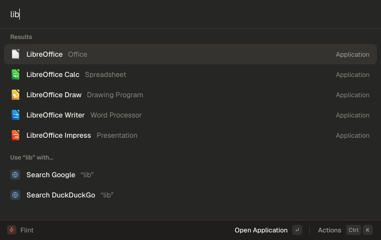
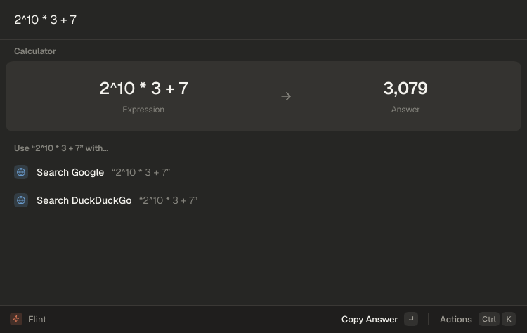
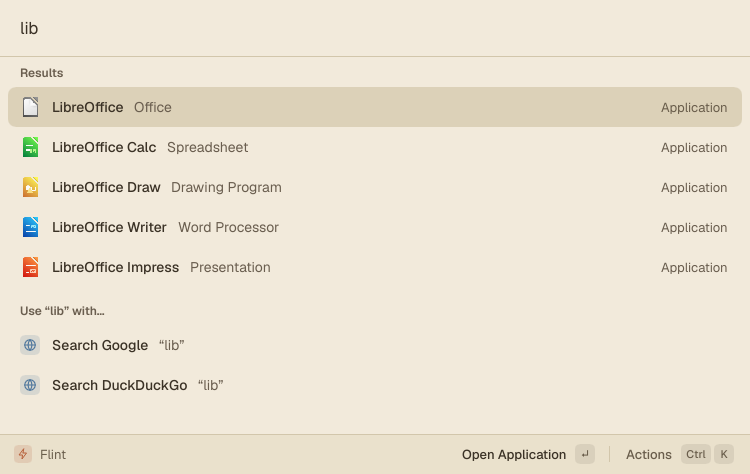
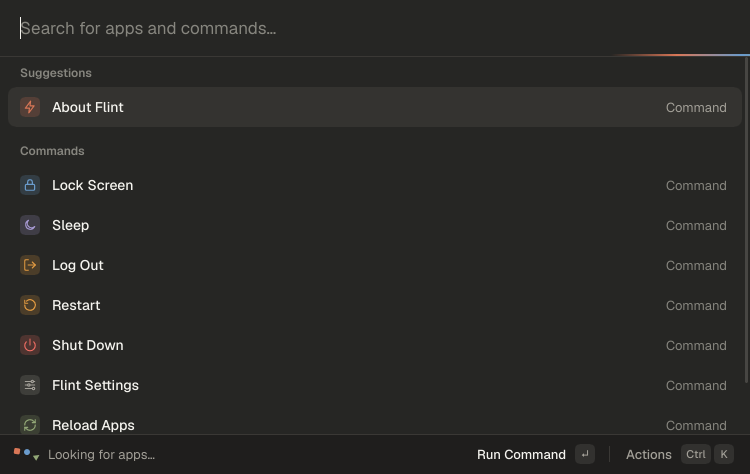
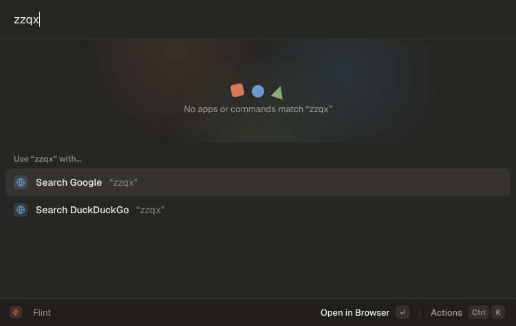
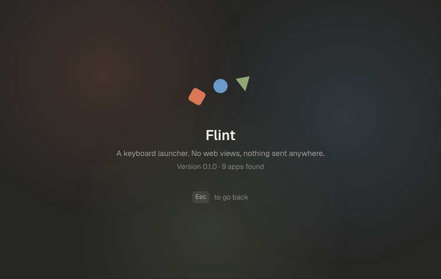

# Flint

A keyboard launcher in the style of Raycast. Press Alt+Space, type a few letters, press Enter.

It's a native program: Rust, with the UI drawn by [Slint](https://slint.dev) on the CPU. There's no browser engine
inside it, no GPU context, no account, no AI and nothing sent anywhere. When the window is closed it's destroyed, so
between uses Flint holds a list of your apps and little else.


| Searching                          | The calculator                             | Actions (Ctrl K)                     |
| ---------------------------------- | ------------------------------------------ | ------------------------------------ |
|       |      |          |
| **Before logging out or similar**  | **A light palette (Sepia)**                | **Looking for apps**                 |
|     |                    |          |
| **Nothing found**                  | **About Flint**                            |                                      |
|  |              |                                      |

## What it costs

Measured with the release build on Linux, under a virtual X server (Xvfb, no compositor) with a dozen apps installed.
A real desktop with hundreds of apps will use a little more for the list and the icons:

| | |
| --- | --- |
| Memory, window closed | 19 MB resident. 2.6 MB of that is Flint's own heap; the rest is its code, which the system can drop and read back |
| Memory, window open | 20 MB |
| Asked to open → window on screen | 7 to 10 ms (via `flint show`), the window being made fresh each time |
| CPU while closed | 0.03% over 30 seconds: one thread inside Slint's Linux settings watcher wakes twice a second |
| Binary | 17 MB, fonts and icons included |

Windows and macOS haven't been measured yet (see [Status](#status)).

## Using it

| Keys | |
| --- | --- |
| Alt+Space | Open or close Flint (change it in config.toml) |
| ↑ ↓, Ctrl N / Ctrl P | Move through the list; Page Up and Page Down jump |
| Enter | Open the app, run the command, copy the answer |
| Ctrl Enter | The second action: show the app in your file manager, copy a link |
| Ctrl K | All actions for the selected item, with their own search |
| Esc | Clear what you typed, then close |
| Ctrl , | Open config.toml |

On macOS, Ctrl is ⌘ throughout.

What you can find:

- **Apps**, the way your system lists them: `.desktop` files on Linux (Flatpak and Snap included), everything in Start
  on Windows (Store apps too), the Applications folders on macOS. Icons come from the system.
- **Sums**, typed straight in: `2^10 * 3 + 7`, `15% * 80`, `sqrt 2`, `7 mod 3`. Enter copies the answer.
- **System commands**: Lock Screen, Sleep, Log Out, Restart, Shut Down. The last three ask first.
- **Web searches and links**: every query ends with "Search Google" and "Search DuckDuckGo" (add your own), and
  something that looks like a link, like `github.com/rust-lang`, can be opened directly.
- **Themes**: type "theme" for the palettes from Blight's dashboard (Ember, Midnight, Moss, Dusk, Black, Paper, Sepia,
  Mist). Picking one saves it.

Blight's tumbling shapes and its colour glow are here too. While Flint looks for apps, a line of clay, blue and green
runs under the search field and the shapes toss in the bar. When nothing matches, they lie where they fell on a still
glow. When something works, like copying an answer, they hop twice. "About Flint" shows them over the drifting glow.

Flint remembers what you pick for what you type, so if `f` once led you to Firefox, `f` puts Firefox first next time.
That's kept in `usage.toml` on your computer and nowhere else. Ctrl K → Reset Ranking forgets an item.

## Settings

`config.toml` lives in `~/.config/flint/` on Linux, `%APPDATA%\flint\` on Windows and
`~/Library/Application Support/flint/` on macOS. It's written with comments the first time Flint starts, and read again
each time the window opens.

```toml
hotkey = "Alt+Space"          # "Ctrl+Shift+Space", "Super+KeyF", …
theme = "system"              # or a palette by name
dark_theme = "ember"
light_theme = "paper"
hide_on_blur = true

[[search]]
name = "GitHub"
url = "https://github.com/search?q={query}"
```

## Building

You need Rust 1.92 or newer.

```bash
cargo run              # a debug build
cargo build --release  # target/release/flint
cargo test
```

On Linux, winit loads `libxkbcommon-x11` at runtime; most desktops have it (`apt install libxkbcommon-x11-0` if not).

### Starting at login

- **Linux**: add `flint --hidden` to your desktop's autostart, or copy a `.desktop` file with `Exec=flint --hidden`
  into `~/.config/autostart/`.
- **Windows**: put a shortcut to `flint.exe --hidden` in `shell:startup`.
- **macOS**: add it under System Settings → General → Login Items.

### Wayland

Wayland doesn't let an app take a key for itself, so Flint can't grab Alt+Space there. Bind a key to `flint toggle` in
your compositor instead (GNOME: Settings → Keyboard → Custom Shortcuts; Sway/Hyprland: a `bindsym`/`bind` line).
Wayland also decides where windows go, so Flint can't centre itself there.

## How it's put together

```
ui/              the window, in Slint's markup
  app.slint      the launcher: search field, list, the bar along the bottom, keyboard handling
  parts.slint    rows, the calculator card, the actions panel, the confirm dialog, keycaps
  motion.slint   the tumbling shapes, the drifting glow and the loading line
  theme.slint    colour tokens (set from Rust) and motion timings
  icons/         Flint's own glyphs, drawn on tinted squares
src/
  main.rs        arguments, one-instance check, picking the CPU renderer
  app.rs         the state behind the window: typing, moving, Enter, actions, toasts
  window.rs      opening, placing and closing the window
  search.rs      what you typed → calculator, ranked matches, fallbacks
  catalog.rs     the item model, and Flint's own commands
  apps/          finding and launching apps: linux.rs, windows.rs, macos.rs
  calc.rs        the arithmetic parser
  icons.rs       loading icons on demand, scaled to 64px
  hotkey.rs      the global key (an X11 grab on Linux; global-hotkey elsewhere)
  ipc.rs         the socket behind `flint toggle`
  usage.rs       what you open, for ranking
  config.rs      config.toml
  palettes.rs    Blight's palettes
fonts/           Geist (SIL Open Font License)
```

Things that keep it light, if you're changing it:

- **Nothing draws while closed.** Hiding destroys the window (`SLINT_DESTROY_WINDOW_ON_HIDE`) and drops the text
  field's focus, which stops the caret's blink timer.
- **Nothing polls.** The hotkey thread, the socket thread and the event loop all sleep until something happens.
- **Animations exist only while they're on screen.** The shapes, the glow and the loading line are each put on screen
  with an `if` and read `animation-tick()`, which stops once they're gone. Slint's CPU renderer can't rotate an
  element, so the shapes are paths whose corners `motion.slint` turns itself.
- **Icons load when a row first shows them**, and anything bigger than 64px is scaled down before it's kept.
- **Apps are found on a background thread** at start and when the window opens, at most every two minutes.

## Status

Built and used on Linux under X11. The Windows and macOS code compiles and passes clippy for both targets, but hasn't
been run on either system yet, so expect rough edges there: window placement on more than one screen, focus
returning to the previous app on macOS, and app icons on macOS (read from `.icns` files, which some newer apps no longer
ship).

Not done yet: clipboard history, file search, snippets, extensions, a tray icon.

## Licence

GPL-3.0, since Slint is used under its GPL licence. Geist is under the SIL Open Font License (`fonts/OFL.txt`).
The palettes and the look come from [Blight](https://github.com/bluejutzu/blight).
