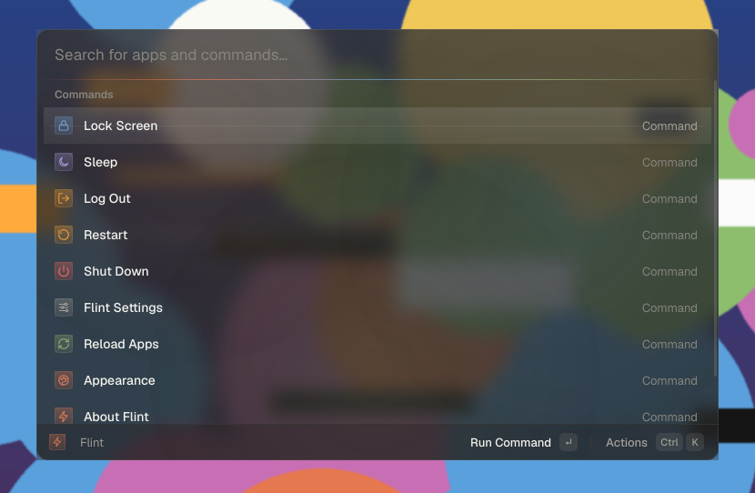
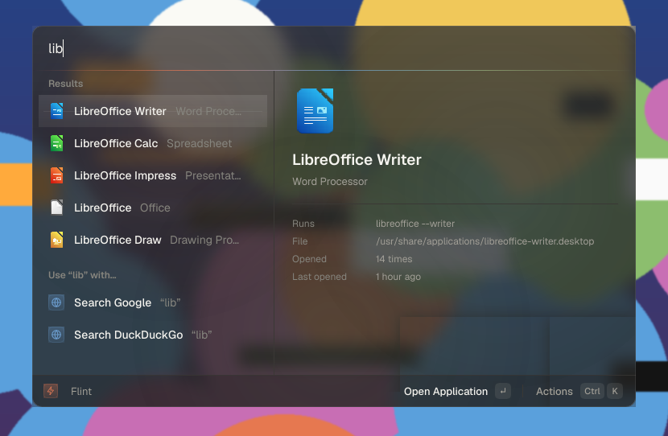
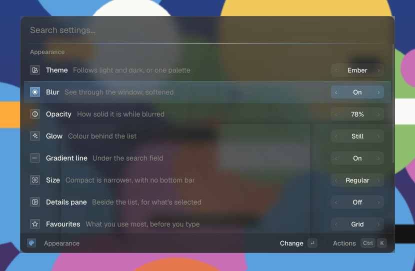
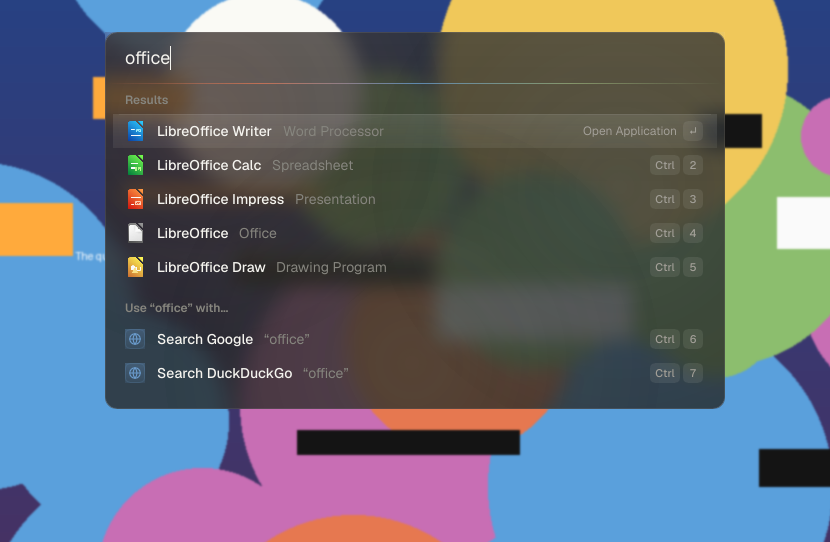
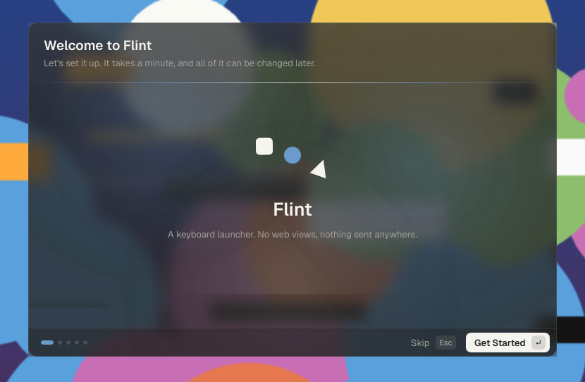

# Tendril

By Loam, alongside [Blight](https://github.com/bluejutzu/blight).

A keyboard launcher in the style of Raycast. Press Alt+Space, type a few letters, press Enter.

It's a native program: Rust, with the UI drawn by [Slint](https://slint.dev) on the CPU. There's no browser engine
inside it, no GPU context (unless you ask for one), no account, no AI and no tracking. What it sends: an update check to
GitHub, and, once per site, a request for the icon of each website you've made a quicklink to. Both can be turned off. When the window is closed it's destroyed, so between uses Tendril holds a list of your apps and
little else.

## Installing

Download the file for your system from [Releases](https://github.com/devatloam/tendril/releases):

- **Linux** (x86_64): `tendril-<version>-linux-x86_64.tar.gz`. Unpack it and run `./install.sh`: it puts Tendril in
  `~/.local/bin` with a menu entry, and needs no root.
- **Windows** (x86_64): `tendril-<version>-windows-x86_64.zip`. Put `tendril.exe` somewhere of your own, like
  `%LOCALAPPDATA%\Programs\Tendril`, and run it. Running it again brings up the copy that's already running. If
  Raycast or PowerToys Run is installed, it probably holds Alt+Space already; Tendril says so when it opens, and the
  first-run walkthrough asks you for other keys.
- **macOS**: `tendril-<version>-macos-aarch64.zip` for Apple silicon, `-x86_64` for Intel. Move Tendril.app to
  Applications. It isn't signed yet, so open it the first time with right-click → Open.

The first run walks you through setting it up. After that Tendril keeps itself up to date: it checks GitHub every six
hours while it runs, and on "Automatic" downloads the new version, checks it against the checksum the release lists,
and puts it in place for the next start. "Check for Updates" asks now; Appearance → Updates switches it to "Tell me" or
off. A copy you built yourself, or one in a folder Tendril can't write to, tells you about new versions but doesn't
replace itself.

### Preview versions

Once a night, if main has changed since the last one, the newest commit that passed its checks is built and published
as a nightly: a prerelease named like `v0.2.1-nightly.20261115.42`, the next version, then what kind of preview it is,
the day and the build number. Changes pile up between nightlies rather than each getting its own, as T3 Code does it. They get new things first and can be
rough. When there's one newer than what you have, the Update section at the top of the list offers "Install Preview
Version?"; taking it switches you to previews, and Tendril installs each new one as it comes. A preview sorts before the
release it leads up to, so once 0.2.1 itself is out you move on to it. Appearance → Preview versions sets this to Ask,
Always or Never ("Don't Offer Previews" in the row's actions does the same as Never). Only the ten newest nightlies are
kept, about ten days' worth.



| Favourites and commands            | Details beside the list                    | Actions (Ctrl K)                       |
| ---------------------------------- | ------------------------------------------ | -------------------------------------- |
|        |                |            |
| **Appearance**                     | **Compact, with quick keys**               | **The calculator**                     |
|  |                |  |
| **First run**                      | **Recording your shortcut**                | **Before logging out or similar**      |
|        |              |         |

## What it costs

Measured with the release build on Linux, under a virtual X server (Xvfb, no compositor) with a dozen apps installed.
A real desktop with hundreds of apps will use a little more for the list and the icons:

| | |
| --- | --- |
| Memory, window closed | 19 MB resident. 2.6 MB of that is Tendril's own heap; the rest is its code, which the system can drop and read back |
| Memory, window open | 20 MB |
| Asked to open → window on screen | 7 to 10 ms (via `tendril show`), the window being made fresh each time |
| CPU while closed | 0.03% over 30 seconds: one thread inside Slint's Linux settings watcher wakes twice a second |
| Binary | 17 MB, fonts and icons included |
| Blur on Windows, macOS or Wayland | Needs the GPU renderer. Under Mesa's software OpenGL that was about 60 MB more heap, kept while Tendril runs; real drivers differ. That's why blur starts off there, and on under X11, where it costs nothing |

Windows and macOS haven't been measured yet (see [Status](#status)).

## Using it

| Keys | |
| --- | --- |
| Alt+Space | Open or close Tendril (record another in Appearance → Shortcut) |
| ← → | Along the favourite tiles, or through a setting's choices |
| Ctrl 1–9 | Open the first nine rows, with quick keys on |
| ↑ ↓, Ctrl N / Ctrl P | Move through the list; Page Up and Page Down jump |
| Enter | Open the app, run the command, copy the answer |
| Ctrl Enter | The second action: show the app in your file manager, copy a link |
| Ctrl K | All actions for the selected item, with their own search |
| Esc | Clear what you typed, then close |
| Ctrl , | Open config.toml |

On macOS, Ctrl is ⌘ throughout.

What you can find:

- **Apps**, the way your system lists them: `.desktop` files on Linux (Flatpak and Snap included), everything in Start
  on Windows (Store apps too), the Applications folders on macOS. Icons come from the system.
- **Sums**, typed straight in: `2^10 * 3 + 7`, `15% * 80`, `sqrt 2`, `7 mod 3`. Enter copies the answer.
- **System commands**: Lock Screen, Sleep, Log Out, Restart, Shut Down. The last three ask first.
- **Web searches and links**: every query ends with "Search Google" and "Search DuckDuckGo" (add your own), and
  something that looks like a link, like `github.com/rust-lang`, can be opened directly.
- **Files**: type a path, `~/`, `/` or `C:\`, and that folder is listed as you type. Enter goes into a folder or opens a
  file, Ctrl Enter shows it in your file manager. Hidden files show once you type a dot. Nothing is indexed: the folder
  is read while you're typing its path, and that's all.
- **Quicklinks**: your own links in config.toml. Give one a keyword and `{query}`, and `gh devatloam/tendril` opens
  that repository; leave the keyword out and it's a bookmark you search for by name. Folders work as well as web
  addresses.
- **Clipboard history**: "Clipboard History" lists the text you've copied, newest first, and narrows as you type.
  Enter pastes it into the window you were in (Ctrl Enter only copies it); Ctrl K deletes one or clears them all. On X11
  and Windows Tendril hears about each copy as it happens, without polling; on macOS and Wayland it reads the clipboard
  when it opens, so you get your latest copy rather than every one in between, and Enter copies rather than pastes.
  Copies a password manager marks as secret are skipped where the system shows the mark (Windows, and KDE on X11).
  Kept in `clipboard.json` beside usage.toml, readable only by you; turning it off deletes it.
- **Switch Windows**: every open window, most recently used first. Enter brings it forward, Ctrl K closes it. X11 and
  Windows; macOS only shows other apps' windows to apps with the Screen Recording permission, and Wayland doesn't at all.
- **Themes**: type "theme" for the palettes from Blight's dashboard (Ember, Midnight, Moss, Dusk, Black, Paper, Sepia,
  Mist). Picking one saves it.

Things that have an icon of their own keep it, in its own colours: apps, files and folders (from your icon theme on
Linux, from Windows itself there), web searches and links (your default browser's), quicklinks (the site's own). Tendril
draws icons only for its own commands, the way Blight's dashboard draws them, on Lucide's 24 grid with an outline and a
solid; `scripts/icons.py` draws both from one description. The selected row is a plain white wash, as in Raycast; blue
is kept for Tendril's mark and a few small accents, and other colours appear only where they mean something (red for
shutting down, green when something worked). Appearance can make the selection blue, the icons bolder, or the whole
thing Modern.

Blight's tumbling shapes and its colour glow are here too. While Tendril looks for apps, a line of clay, blue and green
runs under the search field and the shapes toss in the bar. When nothing matches, they lie where they fell on a still
glow. When something works, like copying an answer, they hop twice. "About Tendril" shows them over the drifting glow.

Tendril remembers what you pick for what you type, so if `f` once led you to Firefox, `f` puts Firefox first next time.
That's kept in `usage.toml` on your computer and nowhere else. Ctrl K → Reset Ranking forgets an item.

## First run

The first time it opens, Tendril walks you through five short steps: a welcome, the shortcut that opens it (press the
keys you want; it checks no other app holds them), how it looks, how it's laid out, and done. Esc goes back, or skips
from the first step. "Set Up Tendril" runs it again.

## Appearance

Search for "Appearance". Every row changes with Enter or ← →, shows straight away and is saved to config.toml:

| Setting | Choices |
| --- | --- |
| Shortcut | Select it and press new keys |
| Theme | System, or one of Blight's palettes |
| Style | Flat (plain fills, drawn on the CPU), or Modern: gradients and a sheen, drawn with the GPU, which keeps tens of megabytes more |
| Selection | White, or blue |
| Icons | Subtle squares behind Tendril's icons, or bold ones (with a blue selection, the selected one turns blue) |
| Blur | See through the window, softened by the system |
| Blur type | Windows: Acrylic (blurs what's behind), Mica and Mica Alt (tinted by your wallpaper, Windows 11), Blur (Windows 10). macOS: HUD, Popover, Sidebar, Menu, Under window. Not on Linux, where the compositor decides |
| Opacity | 60 to 100%, while blurred |
| Glow | Still, drifting, or off |
| Gradient line | Under the search field |
| Size | Regular, or compact: narrower, shorter rows, as tall as its results, no bottom bar |
| Details pane | The selected item's details beside the list |
| Favourites | A grid of tiles, or a list |
| Quick keys | Ctrl 1–9 on the first nine rows |
| Headings | Above each group |
| Close on click away | |
| Open at login | Starts hidden when you log in |
| Clipboard history | On or off; off deletes what's kept |
| Website icons | Quicklinks with their site's icon, fetched once from that site |
| Updates | Automatic, Tell me, or Off |
| Preview versions | Ask, Always, or Never |

Switching between Flat and Modern, or blur on or off where it needs the GPU renderer, restarts Tendril, which takes
about a second.

### Where the blur comes from

- **Windows**: the system's acrylic or Mica, asked for through `window-vibrancy`.
- **macOS**: an `NSVisualEffectView` with the material you pick.
- **Linux, X11**: Tendril draws a see-through window. KDE blurs behind it when asked, and Tendril asks. With picom, turn on
  `blur-background`; without a compositor the window is just translucent.
- **Linux, Wayland**: Hyprland, and Sway with SwayFX, blur see-through windows by their own settings; GNOME doesn't.

## Settings

`config.toml` lives in `~/.config/tendril/` on Linux, `%APPDATA%\tendril\` on Windows and
`~/Library/Application Support/tendril/` on macOS. It's written with comments the first time Tendril starts, and read again
each time the window opens.

```toml
hotkey = "Alt+Space"          # "Ctrl+Shift+Space", "Super+KeyF", …
theme = "system"              # or a palette by name
dark_theme = "ember"
light_theme = "paper"
hide_on_blur = true
updates = "auto"              # "notify", "off"
previews = "ask"              # "always", "never"

[appearance]
blur = true
blur_style = "acrylic"       # Windows; "hud" and the others on macOS
opacity = 0.78
glow = "still"               # "drift", "off"
size = "regular"             # "compact"
details = false
favourites = "grid"          # "list"
quick_keys = false

[[search]]
name = "GitHub"
url = "https://github.com/search?q={query}"

[[quicklink]]
name = "GitHub repository"
keyword = "gh"
url = "https://github.com/{raw}"     # {raw} as typed, {query} made safe for a URL

[[quicklink]]
name = "Projects"
url = "~/Projects"
```

## Building

You need Rust 1.92 or newer.

```bash
cargo run              # a debug build
cargo build --release  # target/release/tendril
cargo test
```

On Linux, winit loads `libxkbcommon-x11` at runtime; most desktops have it (`apt install libxkbcommon-x11-0` if not).

### Releasing

The release scripts need [Bun](https://bun.sh) and nothing else (no `bun install`):

```bash
bun run bump patch --dry-run   # what the next version and its notes would be
bun run bump minor --push      # 0.1.4 → 0.2.0: sets Cargo.toml and Cargo.lock, commits, tags v0.2.0, pushes
```

`bump` takes `patch`, `minor`, `major` or an exact version like `1.0.0`. Without `--push` it commits and tags locally and
prints the push command. The tag starts `release.yml`, which builds every system and publishes the release the updater
offers. Where tags can't be pushed (Claude's cloud sessions refuse them), push the bump commit to main and run the
Release workflow instead, from the Actions tab or with `gh workflow run release.yml --ref main`: it checks the version
in Cargo.toml and makes the tag itself. Nightlies need nothing: `nightly.yml` builds the newest commit on main that passed
its checks once a night (03:17 UTC), and skips nights with nothing new. Its "Run workflow" button makes one now.

Release notes follow T3 Code's: a header with the number of changes and contributors, a bullet for each change worth
reading about (up to seven, with the first sentence of the commit message's prose), a count of what's left
("Plus 3 more bug fixes"), and every commit folded under "Full changelog". Commits starting with `fix:` are counted as
fixes; `docs:`, `chore:`, `ci:`, `test:`, `build:`, `style:` and `refactor:` are listed in the full changelog only.
T3 Code has a model write its bullets; these come straight from the commit messages, so a clear subject line is the
changelog. When the commits don't tell the story (a first release, say), write `notes/v1.2.3.md` before bumping: it
replaces the bullets, and the header and full changelog stay.

### Starting at login

Turn on "Open at login" in Appearance or during the first run. It writes `~/.config/autostart/tendril.desktop` on Linux,
a `Tendril` value under `HKCU\Software\Microsoft\Windows\CurrentVersion\Run` on Windows, and
`~/Library/LaunchAgents/dev.loam.tendril.plist` on macOS, each running `tendril --hidden`.

### Wayland

Wayland doesn't let an app take a key for itself, so Tendril can't grab Alt+Space there. Bind a key to `tendril toggle` in
your compositor instead (GNOME: Settings → Keyboard → Custom Shortcuts; Sway/Hyprland: a `bindsym`/`bind` line).
Wayland also decides where windows go, so Tendril can't centre itself there.

## How it's put together

```
ui/              the window, in Slint's markup
  app.slint      the launcher: search field, list, the bar along the bottom, keyboard handling
  parts.slint    rows, the calculator card, the actions panel, the confirm dialog, keycaps
  motion.slint   the tumbling shapes, the drifting glow and the loading line
  theme.slint    colour tokens (set from Rust) and motion timings
  icons/         Tendril's own icons, outline and solid (drawn by scripts/icons.py)
src/
  main.rs        arguments, one-instance check, picking the renderer, restarting
  app.rs         the state behind the window: typing, moving, Enter, actions, toasts, the first run
  appearance.rs  the Appearance view's settings
  autostart.rs   open at login, per system
  window.rs      opening, placing and closing the window
  search.rs      what you typed → calculator, ranked matches, fallbacks
  catalog.rs     the item model, and Tendril's own commands
  apps/          finding and launching apps: linux.rs, windows.rs, macos.rs
  calc.rs        the arithmetic parser
  icons.rs       loading icons on demand, scaled to 64px
  hotkey.rs      the global key (an X11 grab on Linux; global-hotkey elsewhere)
  ipc.rs         the socket behind `tendril toggle`
  update.rs      checking GitHub for a new version or preview, and putting it in place
  paths.rs       listing a folder as you type its path
  clipboard.rs   clipboard history: hearing about copies (XFixes, a Windows listener), keeping them, pasting
  switcher.rs    open windows: listing, bringing forward, closing
  browser.rs     which browser is the default, for its icon
  sites.rs       fetching and keeping quicklinks' site icons
  usage.rs       what you open, for ranking
  config.rs      config.toml
  palettes.rs    Blight's palettes
fonts/           Geist (SIL Open Font License)
assets/          Tendril's app icon, as SVG, PNG, ICO and ICNS
packaging/       what goes into a release besides the binary: the Linux menu entry and installer, the macOS Info.plist
scripts/         icons.py draws ui/icons/; release.ts versions, bumps and writes release notes (bun run bump)
.github/         check.yml on every push; nightly.yml once a night; release.yml on a version tag or by hand; build.yml for both
```

Things that keep it light, if you're changing it:

- **Nothing draws while closed.** Hiding destroys the window (`SLINT_DESTROY_WINDOW_ON_HIDE`) and drops the text
  field's focus, which stops the caret's blink timer.
- **Nothing polls.** The hotkey thread, the socket thread and the event loop all sleep until something happens.
- **Animations exist only while they're on screen.** The shapes, the glow and the loading line are each put on screen
  with an `if` and read `animation-tick()`, which stops once they're gone. Slint's CPU renderer can't rotate an
  element, so the shapes are paths whose corners `motion.slint` turns itself.
- **Icons load when a row first shows them**, and anything bigger than 64px is scaled down before it's kept.
- **Apps are found on a background thread** at start and when the window opens, at most every two minutes.

## Status

Built and used on Linux under X11, with blur checked under picom. The Windows and macOS code compiles and passes clippy
for both targets, but hasn't been run on either system yet, so expect rough edges there: the blur types (Acrylic, Mica,
the macOS materials), open at login, window placement on more than one screen, focus returning to the previous app on
macOS, and app icons on macOS (read from `.icns` files, which some newer apps no longer ship).

Clipboard history and Switch Windows have been tried under X11 (with Openbox) only; their Windows code compiles and
passes clippy but hasn't run yet. Website icons couldn't be tried against real sites from where this was built.

Not done yet: file search, snippets, extensions, a tray icon, switching windows on macOS.

## Licence

GPL-3.0, since Slint is used under its GPL licence. Geist is under the SIL Open Font License (`fonts/OFL.txt`).
The palettes and the look come from [Blight](https://github.com/bluejutzu/blight).
